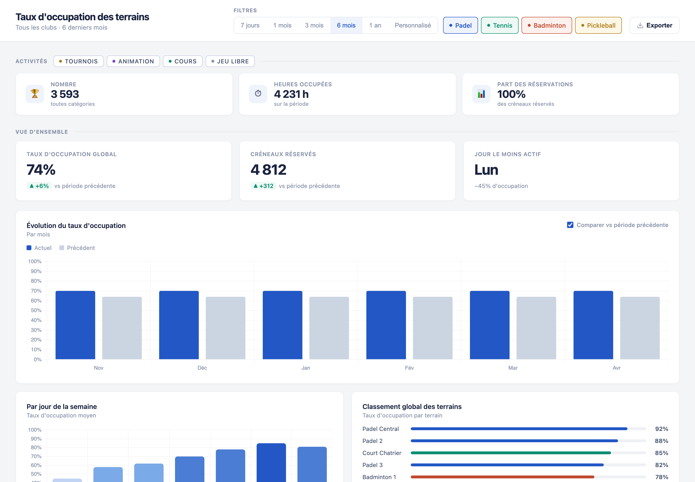

# Dashboards de pilotage pour un réseau de clubs de sports de raquette

> **EN.** Three interactive dashboards (court occupancy, customers & loyalty, prepaid wallets) built during my internship at ALL IN GROUP, in plain HTML, CSS and JavaScript with Chart.js. All names and figures are fictitious. **Live demo: https://mbolmier.github.io/Dashboard/**

Trois tableaux de bord interactifs conçus pendant mon stage de Data Analyst chez ALL IN GROUP (2026), pour un réseau de clubs de padel, tennis, badminton et pickleball. Chacun répond à une question de pilotage précise et se lit en quelques secondes : des indicateurs clés en haut, comparés à la période précédente, puis le détail en graphiques.

**Toutes les données sont fictives.** Les noms de clients et les chiffres sont inventés : séries écrites dans le code ou produites par un générateur pseudo-aléatoire à graine fixe. Aucune donnée réelle n'est publiée.



## Démo en ligne

| Dashboard | La question à laquelle il répond | Lien |
|---|---|---|
| Taux d'occupation des terrains | Quels terrains, quels jours et quelles heures sont pleins ou vides ? | [Ouvrir](https://mbolmier.github.io/Dashboard/Taux%20d'occupation%20des%20terrains.html) |
| Clients & fidélisation | Combien de clients sont actifs, qui progresse, qui décroche ? | [Ouvrir](https://mbolmier.github.io/Dashboard/client.html) |
| Wallets clients | Combien d'argent prépayé circule, et comment il est rechargé et dépensé ? | [Ouvrir](https://mbolmier.github.io/Dashboard/wallets.html) |

## Ce que montre chaque dashboard

### 1. Taux d'occupation des terrains

- **Filtres** : période (7 jours, 1, 3 ou 6 mois, 1 an, ou dates personnalisées), sport, type d'activité (tournois, animation, cours, jeu libre).
- **Indicateurs** : taux d'occupation global et créneaux réservés, avec leur variation par rapport à la période précédente ; jour le moins actif ; heures occupées.
- **Graphiques** : évolution mensuelle du taux d'occupation (avec la période précédente en comparaison), occupation moyenne par jour de la semaine, classement des terrains, heures bloquées par les tournois, cours et animations, et une heatmap heure × jour pour repérer les créneaux creux.

### 2. Clients & fidélisation

- **Indicateurs** : total clients, clients actifs sur une fenêtre glissante de 3 mois, nouveaux clients, fréquence moyenne.
- **Segmentation par fréquence de jeu** sur 3 mois : Rookie (1 partie), Spécialiste (2 à 3), Élite (4 à 5), Légende (6 et plus), avec l'évolution de chaque segment et le nombre de clients montés de segment.
- **Flux** : nouveaux clients contre nouveaux inactifs, pour voir si la base grandit ou s'érode.
- **Chiffre d'affaires par catégorie** (sports, restauration, location, abonnements), habitudes de jeu semaine / week-end, et top 50 des clients les plus actifs.

### 3. Wallets clients

- **Photo à une date donnée** : solde total en circulation, wallets actifs, distribution des wallets par tranche de solde (actifs et inactifs).
- **Sur une période** : rechargements, dépenses et répartition des dépenses par catégorie.
- **Historiques mensuels par client** : solde de fin de mois et bonus crédités.

## Comment ça marche

- **Un fichier HTML autonome par dashboard** (HTML, CSS, JavaScript), sans framework ni étape de build : il suffit de l'ouvrir dans un navigateur.
- **Chart.js 4**, chargé depuis un CDN, dessine les barres et les courbes. La heatmap et les tableaux sont construits directement en JavaScript.
- **Données générées dans le navigateur** : un générateur pseudo-aléatoire à graine fixe (`seededRand`, un générateur congruentiel linéaire) produit des séries reproductibles. La même période affiche donc toujours les mêmes chiffres.
- **Un seul point de rafraîchissement** : chaque changement de filtre appelle `refreshAll()`, qui recalcule les indicateurs, les badges de variation par rapport à la période précédente, puis redessine les graphiques.
- **Mise en page adaptée aux écrans plus étroits** (media queries) et **publication avec GitHub Pages**.

## Lancer en local

```bash
git clone https://github.com/mbolmier/Dashboard.git
cd Dashboard
python3 -m http.server 8000
```

Puis ouvrir http://localhost:8000. Ouvrir directement un des fichiers HTML dans le navigateur fonctionne aussi.

## Limites

Ce sont des prototypes de conception : les données sont fictives et le bouton « Exporter » n'est pas encore branché. Pour passer en production, il faudrait remplacer les séries générées par un export des réservations et des ventes, mis à jour automatiquement.

---

Martin Bolmier, étudiant en BUT Science des données · [LinkedIn](https://www.linkedin.com/in/martin-bolmier-501b92301/)
